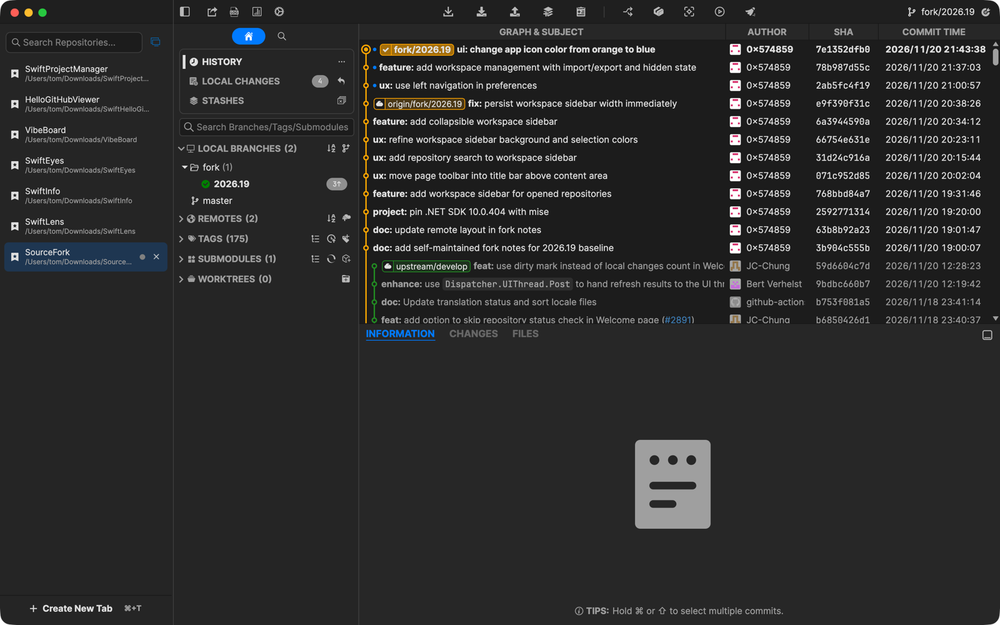

<p align="center">
  
</p>

<h1 align="center">SourceFork</h1>

<p align="center">English | <a href="README.zh-CN.md">简体中文</a></p>

> **SourceFork is a personal fork of [SourceGit](https://github.com/sourcegit-scm/sourcegit), based on `v2026.19`.** It is not affiliated with the upstream project.

> Maintained with an LLM (DeepSeek V4.1 Flash 1017 / OpenCode).

SourceFork keeps SourceGit's Git client and rebuilds the main window around a persistent repository sidebar. The goal is to make switching between repositories faster and more direct, instead of hunting through tabs.

## Screenshots

**Light**


**Dark**



## What's different

- **Flat repository sidebar** — all registered repositories are listed flat on the left and stay in sync with the Welcome page instead of using top tabs. The sidebar is searchable, collapsible, and remembers its width. Drag reordering shows an insertion line, and right click opens the row menu without changing the selection.
- **Repository status in the sidebar** — the repository name is taken from its folder, the row shows the name and secondary tags while the primary tag is shown by the group header, and the branch pill is followed by a freshness label based on the latest commit date (today, this week, this month, or long ago) on the second line; commit dates are cached with the HEAD SHA, so `git log` only runs when HEAD moves, and repository statuses refresh in parallel, and the dirty indicator sits before the name. Paths are hidden by default and can be enabled in preferences. Statuses are refreshed in the background after startup.
- **Simplified repository metadata** — custom bookmarks, the separate edit-repository dialog, and the bookmark icons were removed. Repository names always follow the folder name.
- **Single Welcome page** — there is no blank-page or new-tab concept. The sidebar lists only repositories, and a dedicated button in the title bar opens the one Welcome page (at the right edge of the sidebar title bar on macOS, or leftmost next to the menu button on other platforms).
- **Tags** — give each repository multiple ordered tags with a primary tag, then filter the sidebar or Welcome page by one or more tags (a repository matches when it has any selected tag).
- **Grouping and per-group sorting** — repositories are always grouped by primary tag. Each group can sort its repositories by added time, name, or updated time (with an optional reverse order), or use a custom order defined by dragging inside that group. The group menu keeps collapse/expand and the sort order for that group; visibility, group ordering, and moving groups are configured in the “Manage tag groups…” window, which also exposes each group’s sort order. Everything is remembered.
- **Auto-scan folders** — open a standalone scan window from the Welcome toolbar and register multiple folders. Each folder can scan only its direct children or recurse into subdirectories, and can scan on startup, only manually, or watch for changes in real time. Discovery runs on a background thread and can be stopped at any time; discovered repositories are added without being opened, and scanned repositories that disappear from disk are removed automatically.
- **Clean repository history** — review the repository list and exclude entries one by one, or exclude/restore all entries with one confirmed action. Only repositories with a recorded scan source enter the hidden list; manually added repositories without a source are simply removed. A separate action cleans up every unknown-origin entry at once.
- **Tagged repositories are protected** — repositories with tags are treated as important. Removing one individually requires an extra confirmation, and bulk cleanup skips them automatically.
- **Sidebar remove button** — the close button on a sidebar row removes that repository from the list, closes its page, adds it to the hidden list, and keeps focus on the adjacent repository.
- **No repository groups or workspaces** — manual repository groups and workspaces were removed; all repositories live in one list and are always grouped automatically by primary tag.
- **Preferences** — left-side navigation and a resizable window.
- **Icon** — orange replaced with blue.

## Why v2026.19?

`v2026.19` is the last release before upstream reworked the repository page layout. This fork keeps that layout and builds the flat repository sidebar on top of it, so later upstream fixes and features are ported selectively instead of merged wholesale.

## Build

Requires `git` and the .NET 10 SDK. The repository pins the SDK with `mise`:

```sh
mise install
git submodule update --init --recursive
dotnet build src/SourceFork.csproj -c Debug
dotnet run --project src/SourceFork.csproj
```

## Notes

- See [FORK.md](FORK.md) for the porting workflow and a detailed change log (Chinese).
- Upstream project: <https://github.com/sourcegit-scm/sourcegit>
- License: [MIT](LICENSE)
