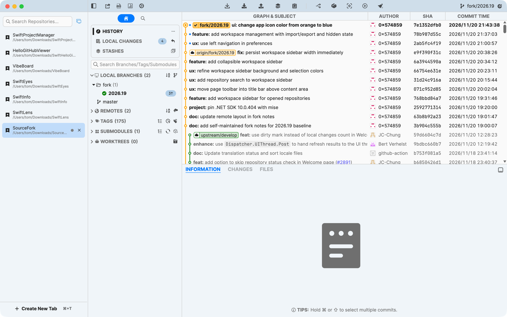

<p align="center">
  
</p>

<h1 align="center">SourceFork</h1>

<p align="center">English | <a href="README.zh-CN.md">简体中文</a></p>

> **SourceFork is a personal fork of [SourceGit](https://github.com/sourcegit-scm/sourcegit), based on `v2026.19`.** It is not affiliated with the upstream project.

> Maintained with an LLM (DeepSeek V4.1 Flash 1017 / OpenCode).

SourceFork keeps SourceGit's Git client and rebuilds the main window around a persistent repository sidebar. The goal is to make switching between repositories faster and more direct, instead of hunting through tabs.

## Screenshots

**Light**



**Dark**


## What's different

- **Flat repository sidebar** — all registered repositories are listed flat on the left and stay in sync with the Welcome page instead of using top tabs. The sidebar is searchable, collapsible, and remembers its width.
- **Tags** — give each repository multiple ordered tags with a primary tag, then filter the sidebar or Welcome page by any combination of tags.
- **Sorting and grouping** — sort repositories by added time, name, or updated time in either direction, drag to define a custom order, and group the list by primary tag.
- **Auto-scan folders** — register multiple folders and keep them forever. Each folder can scan only its direct children or recurse into subdirectories, and can scan on startup, only manually, or watch for changes in real time. Discovery runs on a background thread and can be stopped at any time; discovered repositories are added to the repository list without being opened.
- **Clean repository history** — review the repository list and exclude entries one by one, or exclude/restore all entries with one confirmed action. Excluded repositories are kept in a hidden list; automatic scans skip them and report how many were skipped.
- **Sidebar remove button** — the close button on a sidebar row removes that repository from the list, closes its page, adds it to the hidden list, and keeps focus on the adjacent repository.
- **No groups or workspaces** — repository groups and workspaces were removed; all repositories are shown as a flat list.
- **Preferences** — left-side navigation and a resizable window.
- **Icon** — orange replaced with blue.

## Why v2026.19?

`v2026.19` is the last release before upstream reworked the repository page layout. This fork keeps that layout and builds the flat repository sidebar on top of it, so later upstream fixes and features are ported selectively instead of merged wholesale.

## Build

Requires `git` and the .NET 10 SDK. The repository pins the SDK with `mise`:

```sh
mise install
git submodule update --init --recursive
dotnet build src/SourceFork.csproj -c Debug
dotnet run --project src/SourceFork.csproj
```

## Notes

- See [FORK.md](FORK.md) for the porting workflow and a detailed change log (Chinese).
- Upstream project: <https://github.com/sourcegit-scm/sourcegit>
- License: [MIT](LICENSE)
