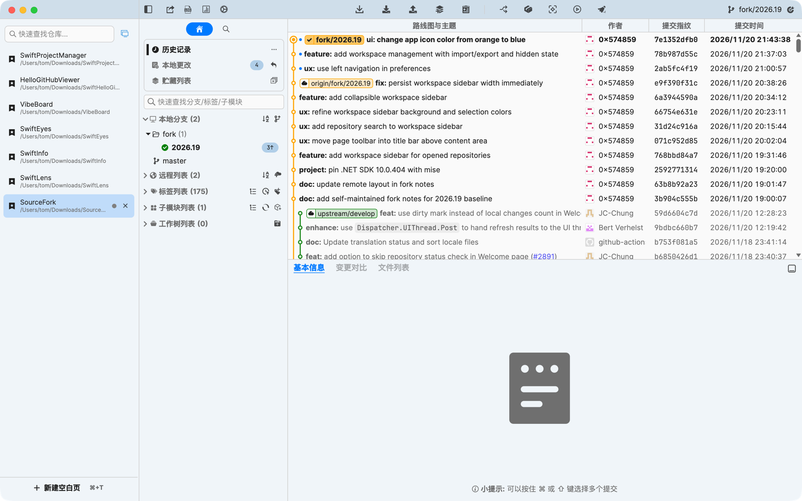

<p align="center">
  
</p>

<h1 align="center">SourceFork</h1>

<p align="center"><a href="README.md">English</a> | 简体中文</p>

> **SourceFork 是 [SourceGit](https://github.com/sourcegit-scm/sourcegit) 的个人分支，基于 `v2026.19`。** 本项目与上游项目无隶属关系。

> 使用 LLM 维护（DeepSeek V4.1 Flash 1017 / OpenCode）。

SourceFork 保留 SourceGit 的 Git 客户端能力，并围绕常驻的仓库侧边栏重构了主界面。目标是在多个仓库之间快速切换，而不是在标签栏里来回寻找。

## 截图

**浅色**



**深色**


## 主要改进

- **平铺仓库侧边栏** — 所有已注册仓库平铺在左侧栏中，并与 Welcome 页保持同步，替代顶部标签页；支持搜索、折叠，并记住宽度。拖动排序会显示插入线，右键会打开对应菜单且不改变当前选中项。
- **侧边栏仓库状态** — 仓库名直接使用目录名，行内只显示仓库名和次要 Tag（主要 Tag 由分组标题显示），第二行分支 pill 后面显示最近一次提交的距今时间（1 天内 / 7 天内 / 30 天内 / 很久）；提交时间会和 HEAD SHA 一起缓存，只有 HEAD 变化时才重新执行 `git log`，仓库状态也会并发刷新，脏状态圆点位于名称前面；仓库路径默认隐藏，可在偏好设置中开启。启动后会在后台刷新状态。
- **简化仓库信息** — 删除自定义书签、独立的“编辑仓库”窗口和列表中的书签图标；仓库名称始终跟随目录名。
- **唯一的欢迎页** — 不再有空白页或新标签页概念。侧边栏只显示仓库，标题栏中的欢迎页按钮用于打开唯一的欢迎页（macOS 上位于侧边栏标题区最右侧，其他平台位于最左侧、菜单按钮在其右侧）。页面采用左右结构：左侧是 Tag 列表（含“全部仓库”和“无 Tag”），右侧显示所选 Tag 的仓库，顶部搜索框横跨两栏。
- **Tag** — 每个仓库可添加多个有序 Tag 并指定主要 Tag；侧边栏支持多选 Tag 筛选（满足任一 Tag 即可显示），Welcome 页左侧是 Tag 列表，点击后右侧显示对应仓库；Tag 编辑窗口会列出其他仓库已使用的 Tag，点击即可复用。
- **分组与组内排序** — 仓库始终按主要 Tag 分组。每个分组可以单独按添加时间、名称、更新时间（可倒序）排列，或使用在组内拖动定义的自定义顺序；分组标题右键菜单保留折叠/展开和当前分组的组内排序；分组显示/隐藏、分组排序和上移/下移调整在“管理标签分组…”窗口中完成，窗口里也可以设置每个分组的组内排序。所有状态都会保存。
- **可配置的仓库工具栏** — 文件浏览器和终端默认显示在最左侧，Fetch/Pull/Push 和中间的“更多”按钮默认显示在中间；贮藏、应用补丁、GitFlow、Git LFS、二分定位、自定义操作和清理默认收进中间的更多菜单；在文件浏览器中打开、日志、统计、设置和聚焦当前分支默认隐藏。左、中、右三个区域各自支持一个更多菜单，左侧和右侧的更多菜单默认不开启。在“偏好设置 → 集成与操作 → 仓库工具栏”中可以为每个操作选择隐藏、左侧、中间、右侧、左侧更多菜单、中间更多菜单或右侧更多菜单。首页（Welcome）工具栏不受影响。
- **自动扫描目录** — 通过 Welcome 工具栏的扫描按钮打开独立窗口，添加多个扫描目录并永久保存。每个目录可选择只扫描单层或递归子目录，并可设置为打开软件时扫描、仅手动扫描或实时监听；目录发现过程在后台执行，可随时停止；扫描只注册仓库，不会自动打开，并会自动移除已从磁盘消失的扫描仓库。
- **拖放导入** — 从文件管理器把文件夹拖到窗口时，整个窗口会变暗并显示导入面板，逐个列出仓库名称、路径及状态（将导入、已在仓库列表中、不是 Git 仓库、路径不存在），包含多个 Git 仓库的工作区会自动展开。默认松开鼠标即导入所有可导入仓库并关闭面板；把文件夹拖到底部的小固定区域可临时固定面板，逐个勾选仓库后点“导入所选”，点关闭按钮或按 Esc 收起。
- **清理仓库历史** — 可逐项排除仓库列表中的条目，也可在确认后一次性全部排除或全部恢复。只有记录了扫描来源的仓库会进入隐藏列表；没有来源的手动仓库只会从列表中移除。窗口提供“清理未知来源”，可一次性移除所有未知来源条目。
- **带 Tag 的仓库受保护** — 打了 Tag 的仓库视为重要仓库；单独删除前需要再次确认，批量清理会自动跳过它们。
- **从列表中移除** — 通过仓库行右键菜单移除仓库；会关闭已打开的页面、写入隐藏列表，并把焦点保持在相邻仓库。关闭标签页/关闭其他标签页及 Ctrl/⌘+W 快捷键已移除。
- **移除仓库分组与工作区** — 不再有手动仓库分组或工作区概念，所有仓库以单一列表展示，并始终按主要 Tag 自动分组。
- **偏好设置** — 左侧导航，窗口可自由调整大小。
- **图标** — 橙色替换为蓝色。

## 为什么基于 v2026.19？

`v2026.19` 是上游重构仓库页面布局之前的最后一个版本。本分支保留这套布局，并在其上实现平铺的仓库侧边栏，因此后续的上游修复和功能只做选择性移植，而不是整体合并。

## 构建

需要 `git` 和 .NET 10 SDK。仓库通过 `mise` 固定 SDK 版本：

```sh
mise install
git submodule update --init --recursive
dotnet build src/SourceFork.csproj -c Debug
dotnet run --project src/SourceFork.csproj
```

## 说明

- 移植流程和详细改动记录见 [FORK.md](FORK.md)。
- 上游项目：<https://github.com/sourcegit-scm/sourcegit>
- 许可证：[MIT](LICENSE)
