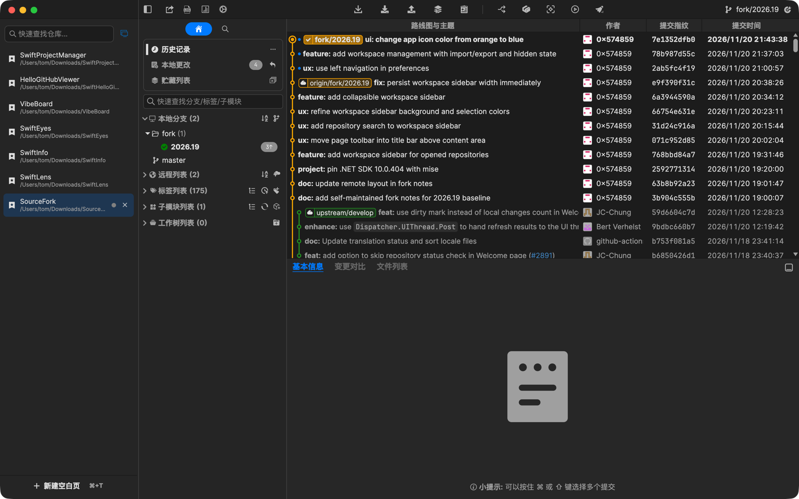

<p align="center">
  
</p>

<h1 align="center">SourceFork</h1>

<p align="center"><a href="README.md">English</a> | 简体中文</p>

> **SourceFork 是 [SourceGit](https://github.com/sourcegit-scm/sourcegit) 的个人分支，基于 `v2026.19`。** 本项目与上游项目无隶属关系。

> 使用 LLM 维护（DeepSeek V4.1 Flash 1017 / OpenCode）。

SourceFork 保留 SourceGit 的 Git 客户端能力，并围绕常驻的仓库侧边栏重构了主界面。目标是在多个仓库之间快速切换，而不是在标签栏里来回寻找。

## 截图

**浅色**


**深色**



## 主要改进

- **平铺仓库侧边栏** — 所有已注册仓库平铺在左侧栏中，并与 Welcome 页保持同步，替代顶部标签页；支持搜索、折叠，并记住宽度。拖动排序会显示插入线，右键会打开对应菜单且不改变当前选中项。
- **侧边栏仓库状态** — 每一行显示 Tag、当前分支、领先/落后提交数量和本地变更数量；启动后会在后台刷新状态。
- **唯一的欢迎页** — 不再有空白页或新标签页概念。侧边栏只显示仓库，底部按钮用于打开唯一的欢迎页。
- **Tag** — 每个仓库可添加多个有序 Tag 并指定主要 Tag，侧边栏和 Welcome 页支持按 Tag 组合筛选。
- **排序与分组** — 支持按添加时间、名称、更新时间正序/倒序排列，拖动定义自定义顺序，并可按主要 Tag 分组；分组可按名称或仓库数量排序，并可单独折叠并记住折叠状态。
- **自动扫描目录** — 通过 Welcome 工具栏的扫描按钮打开独立窗口，添加多个扫描目录并永久保存。每个目录可选择只扫描单层或递归子目录，并可设置为打开软件时扫描、仅手动扫描或实时监听；目录发现过程在后台执行，可随时停止；扫描只注册仓库，不会自动打开，并会自动移除已从磁盘消失的扫描仓库。
- **清理仓库历史** — 可逐项排除仓库列表中的条目，也可在确认后一次性全部排除或全部恢复。只有记录了扫描来源的仓库会进入隐藏列表；没有来源的手动仓库只会从列表中移除。窗口提供“清理未知来源”，可一次性移除所有未知来源条目。
- **带 Tag 的仓库受保护** — 打了 Tag 的仓库视为重要仓库；单独删除前需要再次确认，批量清理会自动跳过它们。
- **侧边栏移除按钮** — 仓库行上的关闭按钮会从列表中移除该仓库、关闭已打开的页面、写入隐藏列表，并把焦点保持在相邻仓库。
- **移除仓库分组与工作区** — 不再有手动仓库分组或工作区概念，所有仓库以单一列表展示；按主要 Tag 的自动分组仍然保留。
- **偏好设置** — 左侧导航，窗口可自由调整大小。
- **图标** — 橙色替换为蓝色。

## 为什么基于 v2026.19？

`v2026.19` 是上游重构仓库页面布局之前的最后一个版本。本分支保留这套布局，并在其上实现平铺的仓库侧边栏，因此后续的上游修复和功能只做选择性移植，而不是整体合并。

## 构建

需要 `git` 和 .NET 10 SDK。仓库通过 `mise` 固定 SDK 版本：

```sh
mise install
git submodule update --init --recursive
dotnet build src/SourceFork.csproj -c Debug
dotnet run --project src/SourceFork.csproj
```

## 说明

- 移植流程和详细改动记录见 [FORK.md](FORK.md)。
- 上游项目：<https://github.com/sourcegit-scm/sourcegit>
- 许可证：[MIT](LICENSE)
